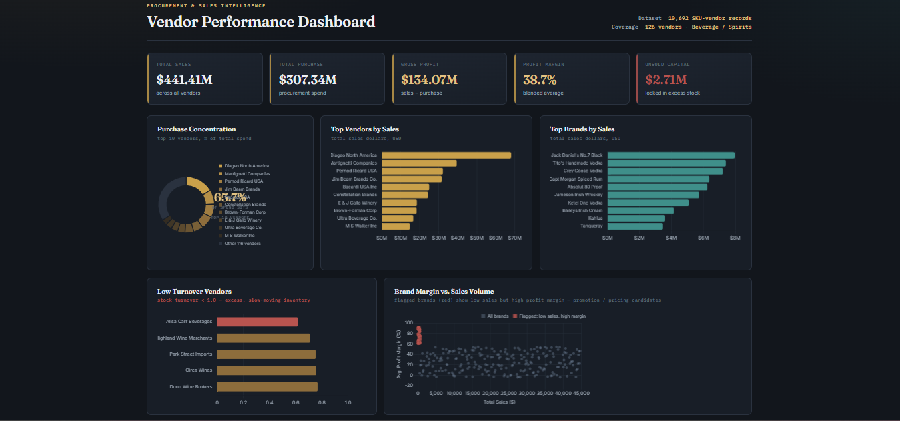

# Vendor Performance Analysis

Analysis of vendor purchase and sales performance using SQL and Python, with an HTML dashboard summarising the results.

## Tools
SQL (SQLite, CTEs), Python (Pandas, SQLAlchemy, SciPy), Jupyter Notebook, Chart.js

## Project Files
- `Ingestion_db.py` - loads raw CSV files into a SQLite database
- `get_vendor_summary.py` - merges purchase, sales and freight tables into a vendor summary and adds GrossProfit, ProfitMargin, StockTurnover and SalesToPurchaseRatio
- `Exploratory_Data_Analysis.ipynb` - exploratory data analysis
- `Vendor Performance Analysis.ipynb` - main analysis and statistical testing
- `Vendor_Performance_Dashboard.html` - dashboard (open in a browser)

## Key Findings
- Purchase quantity and sales quantity are almost perfectly correlated (0.999)
- Bulk purchasing reduces unit cost by about 72%
- Vendors with low sales have statistically higher profit margins (Welch's t-test)
- Top 10 vendors account for 65.7% of total purchase spend

## Dashboard

## Data
Source: Dataset by Ayushi on Topmate - [Vendor Performance Analysis Data](https://topmate.io/ayushi_mishra/1557424)

Raw CSV files and the SQLite database are not included because of their size.

## Note
The "Brand Margin vs. Sales Volume" scatter chart in the dashboard uses illustrative data, not the actual dataset.
